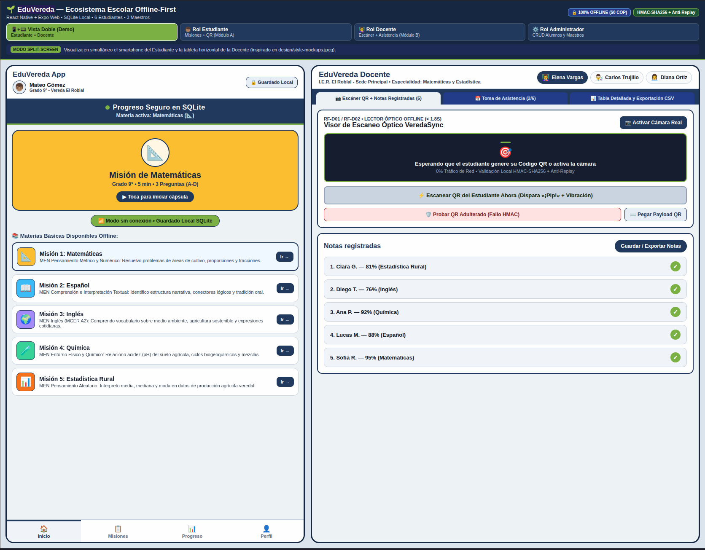
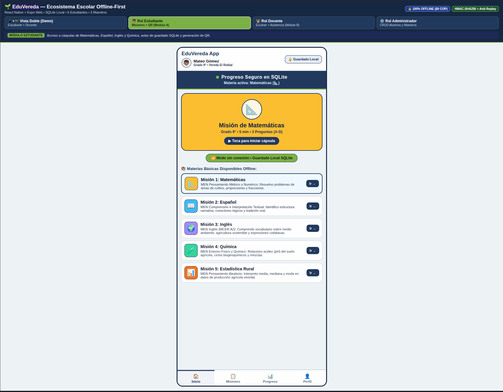
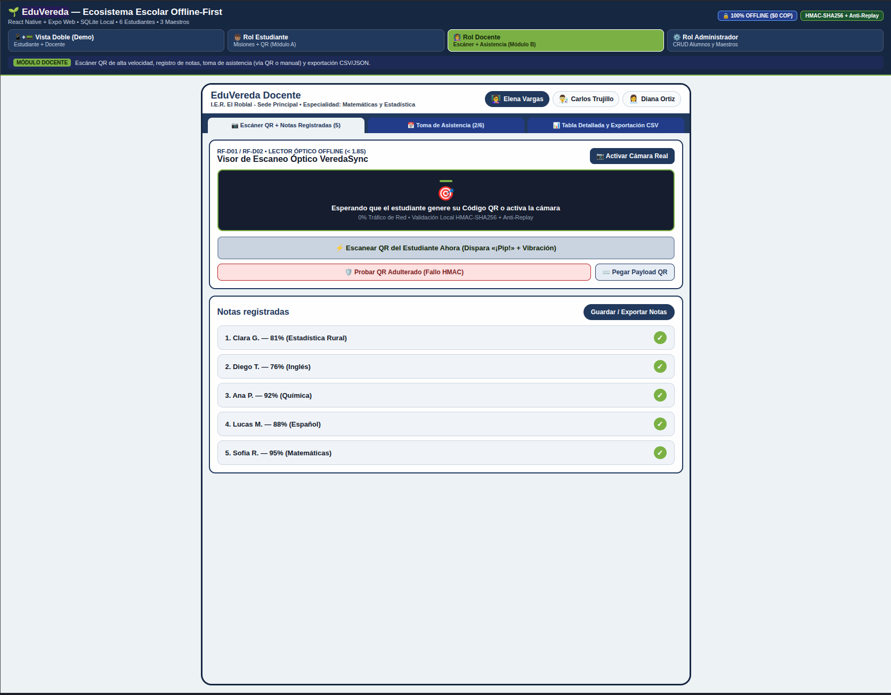
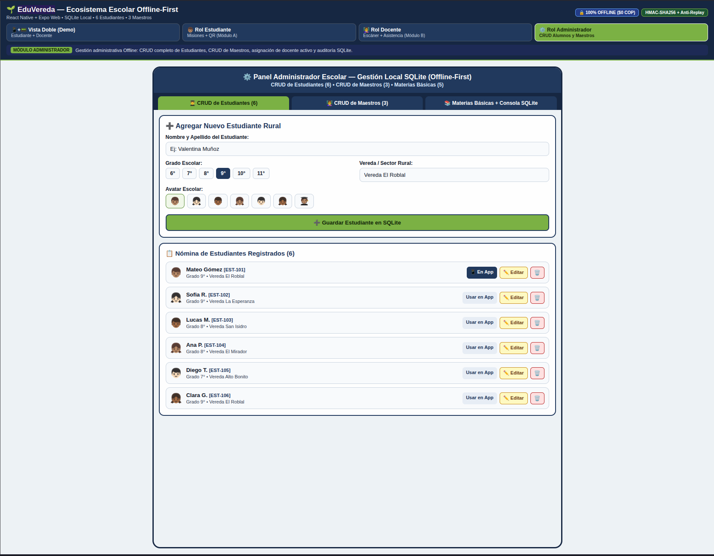
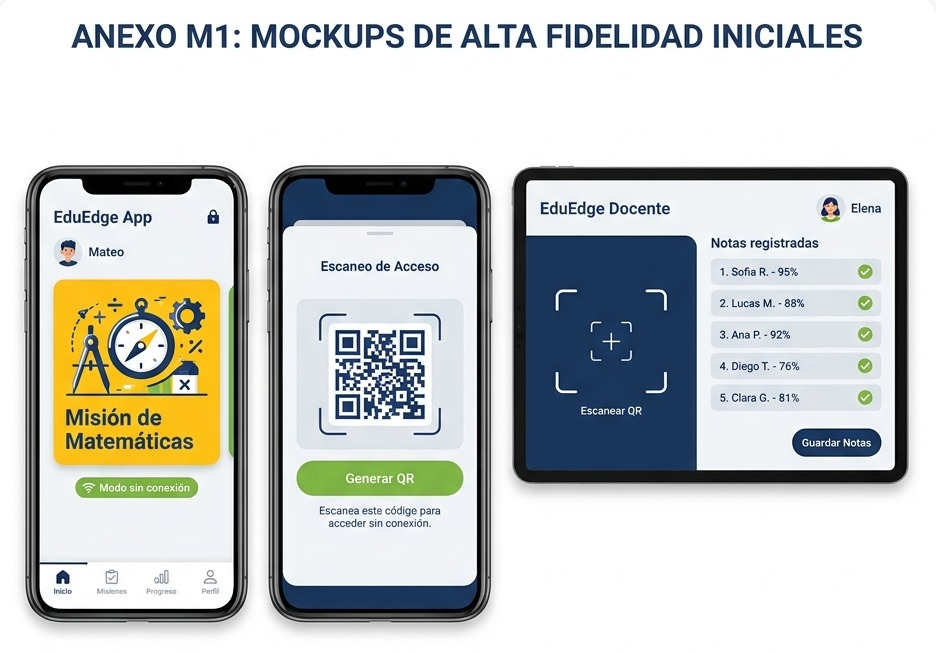
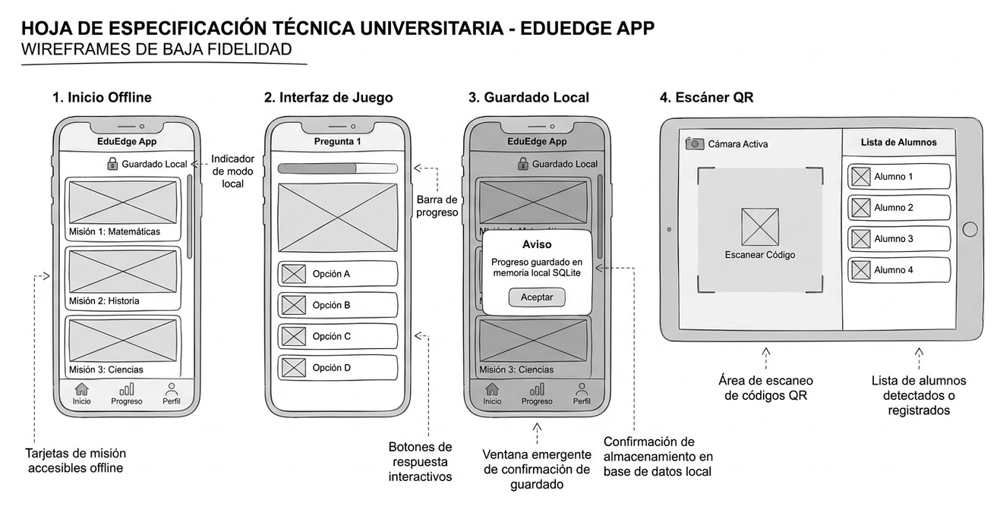

# 🌱 EduVereda — Ecosistema Frugal Multiplataforma (Offline-First)

**EduVereda** es una aplicación multiplataforma desarrollada con **React Native, Expo y React Native Web** bajo **Clean Architecture**, concebida para superar la brecha digital en las escuelas rurales de Colombia sin depender de internet, paquetes de datos móviles ($0 COP) ni servidores en la nube.

El diseño visual e interactivo sigue fielmente los wireframes y mockups ubicados en [`design/mockups.jpeg`](./design/mockups.jpeg) y [`design/style-mockups.jpeg`](./design/style-mockups.jpeg).

---

## 📸 Visualización de la Demo y Aplicación

### 1. Modo Vista Doble (`SPLIT_DEMO` — Estudiante + Docente en Simultáneo)
Permite evaluar en una sola pantalla el flujo completo de extremo a extremo: resolución de cápsulas en el teléfono del estudiante, generación del Código QR firmado con **HMAC-SHA256** y captura óptica inmediata en la tableta de la docente.



---

### 2. Vistas por Rol del Ecosistema

| Rol Estudiante (`EduVereda App`) | Rol Docente (`EduVereda Docente / VeredaSync`) |
| :---: | :---: |
|  |  |
| *Cápsulas de Matemáticas, Español, Inglés, Química y Estadística, guardado local en SQLite y generación de QR dinámico.* | *Escáner óptico QR (< 1.8 s), alerta «¡Pip!» + vibración, notas registradas, toma de asistencia y exportación CSV/JSON.* |

#### Panel de Administración Escolar (`Rol Administrador` — CRUD SQLite)
Gestión local 100% *Offline* para crear, editar y eliminar **Estudiantes** y **Maestros**, asignar el docente titular de la tableta e inspeccionar la bitácora de sentencias SQL parametrizadas:



---

### 3. Mockups y Wireframes de Diseño Original (`design/`)

| Mockups de Alta Fidelidad (`design/style-mockups.jpeg`) | Wireframes de Baja Fidelidad (`design/mockups.jpeg`) |
| :---: | :---: |
|  |  |

---

## 🎯 Módulos y Funcionalidades Principales

1. **Módulo A — EduVereda App (`STUDENT`):**
   - **Materias Básicas Offline:** Cápsulas gamificadas de 5 minutos (*Cultura Snack*) con preguntas de 4 opciones (`A`, `B`, `C`, `D`) para **Matemáticas**, **Español**, **Inglés**, **Química** y **Estadística Rural**.
   - **Persistencia SQLite y Aviso de Guardado Local:** Cada respuesta se guarda transaccionalmente en SQLite y despliega la ventana emergente de confirmación *"Aviso: Progreso guardado en memoria local SQLite"* (Wireframe 3).
   - **Barra de Navegación Inferior:** 4 pestañas (`🏠 Inicio`, `📋 Misiones`, `📊 Progreso`, `👤 Perfil`).
   - **Sincronización Óptica QR:** Botón verde manzana (`#7CB342`) de 60px **«Toca aquí para mostrar a tu profe»** que genera un Código QR dinámico firmado con **HMAC-SHA256**.

2. **Módulo B — EduVereda Docente / VeredaSync (`TEACHER`):**
   - **Diseño de Tableta Horizontal (`design/style-mockups.jpeg`):** Cabecera con selector de maestra activa (ej. *👩‍🏫 Elena Vargas*), visor óptico QR (< 1.8 s) y lista de **Notas registradas** (`1. Sofia R. — 95% ✓`).
   - **Toma de Asistencia Escolar (Híbrida QR + Manual):**
     - **Automática vía QR:** Al escanear el Código QR de un estudiante, además de registrar su calificación, el sistema lo marca automáticamente como **`PRESENTE (📷 Vía QR)`** en la fecha actual.
     - **Manual en Aula:** Pestaña dedicada para marcar **✅ Presente**, **🕒 Tardanza** o **❌ Ausente** por alumno, o marcar a todo el salón presente con un solo botón.
   - **Retroalimentación Multisensorial:** Alerta visual verde, tono **«¡Pip!»** (880 Hz vía Web Audio API) y vibración háptica (`200 ms`).
   - **Exportación Local Segura:** Descarga de consolidado en **CSV** (sanitizado contra *CSV Injection*) y **JSON**.

3. **Módulo C — Panel Administrador (`ADMIN`):**
   - **CRUD Completo de Estudiantes en SQLite:** Crear nuevo estudiante, listar nómina, editar nombre/grado/vereda/avatar, seleccionar alumno activo en el teléfono y eliminar registros.
   - **CRUD Completo de Maestros en SQLite:** Crear nuevo docente, editar especialidad y sede educativa rural, asignar como docente titular de la tableta y eliminar registros.
   - **Consola de Auditoría SQLite en Vivo:** Inspección de todas las sentencias SQL parametrizadas (`INSERT`, `UPDATE`, `DELETE`, `SELECT`) ejecutadas localmente.

---

## 🏛️ Estructura del Proyecto (Clean Architecture)

Todos los archivos están modularizados y comentados, manteniéndose muy por debajo del límite de 700 líneas por archivo:

```text
demo/
├── img/
│   ├── vistaDoble.png                    # Captura del modo Split-Screen (Estudiante + Docente)
│   ├── RolEstudiante.png                 # Captura del Módulo A (EduVereda App)
│   ├── rolDocente.png                    # Captura del Módulo B (EduVereda Docente / VeredaSync)
│   └── rolAdministrador.png              # Captura del Módulo C (Panel Admin CRUD SQLite)
├── design/
│   ├── mockups.jpeg                      # Wireframes de baja fidelidad (Inicio, Juego, Aviso SQLite, Escáner)
│   └── style-mockups.jpeg                # Mockups de alta fidelidad (Teléfono Estudiante y Tableta Docente)
├── docs/
│   └── requerimientos-sistema-eduvereda.md # Especificación formal de requerimientos del sistema
├── flake.nix                             # Entorno reproducible Nix (Node.js 22, pnpm, SQLite, Watchman)
├── .npmrc                                # Configuración pnpm (node-linker=hoisted) para Expo/Metro
├── App.tsx                               # Proveedor raíz de Inyección de Dependencias
└── src/
    ├── domain/                           # 1. CAPA DE DOMINIO (Entidades puras e Interfaces)
    │   ├── entities/
    │   │   ├── Role.ts                   # 4 Roles (SPLIT_DEMO, STUDENT, TEACHER, ADMIN) y perfiles
    │   │   ├── StudentMission.ts         # Misiones de Matemáticas, Español, Inglés, Química y Estadística
    │   │   ├── AttendanceRecord.ts       # Entidades de Toma de Asistencia (Presente, Tardanza, Ausente)
    │   │   └── GradeRecord.ts            # Contrato QR VeredaSync v1 y Registro de Calificaciones
    │   ├── repositories/
    │   │   ├── IStudentRepository.ts     # Contrato de persistencia de progreso del estudiante
    │   │   ├── ITeacherRepository.ts     # Contrato de notas y bloqueo Anti-Replay
    │   │   ├── IRosterRepository.ts      # Contrato CRUD de Estudiantes y Maestros
    │   │   └── IAttendanceRepository.ts  # Contrato de Toma de Asistencia escolar
    │   └── services/
    │       ├── ISecurityService.ts       # Contrato HMAC-SHA256, nonces y sanitización CSV
    │       ├── IFeedbackService.ts       # Contrato de sonido «¡Pip!» y vibración háptica
    │       └── IExportService.ts         # Contrato de exportación CSV / JSON
    │
    ├── application/                      # 2. CAPA DE APLICACIÓN (Casos de Uso desacoplados)
    │   ├── data/
    │   │   └── ruralMissionsCatalog.ts   # Catálogo de 5 materias básicas y nóminas semilla
    │   └── useCases/
    │       ├── CompleteMissionStepUseCase.ts   # Guarda respuestas y calcula nota en SQLite
    │       ├── GenerateSignedQrUseCase.ts      # Empaqueta y firma el QR con HMAC-SHA256
    │       ├── ProcessScannedQrUseCase.ts      # Verifica QR, guarda nota + asistencia y dispara alerta
    │       ├── ManageRosterCrudUseCase.ts      # Lógica CRUD de Estudiantes y Maestros (Rol Admin)
    │       ├── ManageAttendanceUseCase.ts      # Lógica de Toma de Asistencia escolar
    │       └── ExportClassroomGradesUseCase.ts # Exportación segura de notas a CSV / JSON
    │
    ├── infrastructure/                   # 3. CAPA DE INFRAESTRUCTURA (Implementaciones SQLite / Web / Nativo)
    │   ├── database/
    │   │   └── sqliteEngine.ts           # Motor transaccional y bitácora de consultas parametrizadas
    │   ├── repositories/
    │   │   ├── SqliteStudentRepository.ts
    │   │   ├── SqliteTeacherRepository.ts
    │   │   ├── SqliteRosterRepository.ts       # Tabla SQLite de Estudiantes y Maestros (CRUD)
    │   │   └── SqliteAttendanceRepository.ts   # Tabla SQLite de Asistencia Diaria
    │   ├── security/
    │   │   └── HmacSecurityService.ts          # Firma HMAC-SHA256 con expo-crypto
    │   ├── feedback/
    │   │   └── MultisensoryFeedbackService.ts  # Síntesis Web Audio API (880Hz) + expo-haptics
    │   └── export/
    │       └── LocalFileExportService.ts       # Descarga local de archivos CSV y JSON
    │
    └── presentation/                     # 4. CAPA DE PRESENTACIÓN (Interfaces React Native WCAG AAA)
        ├── theme/
        │   └── colors.ts                 # Paleta solar (#1B365D azul marino, #7CB342 verde manzana)
        ├── context/
        │   └── AppContainerContext.tsx   # Contenedor DI y estado global reactivo
        ├── components/
        │   ├── common/
        │   │   ├── SolarBanner.tsx             # Banner RF-E02 «Progreso Seguro en SQLite»
        │   │   └── RoleSwitcherBar.tsx         # Conmutador de los 4 Roles del sistema
        │   ├── student/
        │   │   ├── StudentHomeMissionsView.tsx # Tarjetas de misión estilo design/style-mockups.jpeg
        │   │   ├── MissionQuestionCard.tsx     # Juego de preguntas (A, B, C, D)
        │   │   ├── SqliteSavedPopupModal.tsx   # Ventana emergente de confirmación SQLite (Wireframe 3)
        │   │   └── AchievementQrCard.tsx       # Modal de Código QR firmado y botón verde de 60px
        │   ├── teacher/
        │   │   ├── OpticalScannerCard.tsx      # Visor óptico QR y simulador de adulteración HMAC
        │   │   ├── AttendanceTrackerCard.tsx   # Planilla interactiva de Toma de Asistencia
        │   │   └── ClassroomGradesTable.tsx    # Tabla consolidada y exportación CSV/JSON
        │   └── admin/
        │       ├── StudentCrudManager.tsx      # Formulario y tabla CRUD de Estudiantes
        │       └── TeacherCrudManager.tsx      # Formulario y tabla CRUD de Maestros
        └── screens/
            ├── StudentScreen.tsx         # Smartphone del Estudiante (Módulo A)
            ├── TeacherScreen.tsx         # Tableta Horizontal de la Docente (Módulo B)
            ├── AdminScreen.tsx           # Panel Administrador con CRUDs (Módulo C)
            └── MainDemoScreen.tsx        # Orquestador Split-Screen y Selector de Roles
```

---

## 🚀 Ejecución Rápida con Nix y `pnpm`

```bash
# 1. Activar el entorno reproducible de Nix
nix develop

# 2. Instalar dependencias (si es la primera vez)
pnpm install

# 3. Iniciar la Demo Web interactiva
pnpm run web

# 4. Verificar compilación limpia de TypeScript
pnpm run typecheck
```
